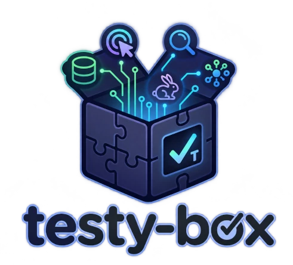

# testy-box: JUnit extensions for Java integration tests

`testy-box` is a collection of JUnit Jupiter extensions for Java integration tests. Start an embedded database or AMQP broker,
load test data, and inject clients directly into your test methods.

Use it to test SQL and MongoDB repositories, Redis access, OpenSearch queries, or code that sends and receives RabbitMQ
messages. Each module covers a specific testing need, so you can add the ones your project uses.

## Modules and documentation

Each module README describes its tools and shows how to use them with Java examples.

| Module | What you can test |
| --- | --- |
| [testy-jooq-box](testy-jooq-box/README.md) | SQL repositories with an in-memory H2 database, Flyway schema migrations, and test data loaded through [jOOQ](https://www.jooq.org/). |
| [testy-mongo-box](testy-mongo-box/README.md) | [MongoDB](https://www.mongodb.com/) repositories with an embedded database, collection data sets, and reactive clients. |
| [testy-redis-box](testy-redis-box/README.md) | [Redis](https://redis.io/) access with an embedded server and an injectable Lettuce client. |
| [testy-search-box](testy-search-box/README.md) | [OpenSearch](https://opensearch.org/) queries with an embedded node and test documents indexed before each test. |
| [testy-beat-box](testy-beat-box/README.md) | RabbitMQ messaging with an embedded [Qpid](https://qpid.apache.org/) AMQP broker, reactive connection options, and helpers to publish messages or simulate replies. |
| [testy-core-box](testy-core-box/README.md) | JSON mapping with Jackson, ordered extension initialization, and detection of non-daemon threads left running after tests. Provides common extensions used by the database and messaging modules. |
| [testy-params-box](testy-params-box/README.md) | Parameterized tests that aggregate CSV arguments into string varargs. |

## How the extensions fit into your tests

Register extensions with JUnit Jupiter using `@RegisterExtension` or, where supported, `@ExtendWith`. The extensions manage
resource setup and teardown through JUnit lifecycle callbacks. Test and lifecycle methods can receive resources such as
a `DataSource`, `DSLContext`, `MongoClient`, `RedisClient`, or `OpenSearchClient` as parameters.

For tests that need several resources, `ChainedExtension` initializes extensions in declaration order and tears them down
in reverse order. For example, you can start an H2 database, apply Flyway migrations, create a jOOQ context, and then load
the records needed by your tests.

The jOOQ, MongoDB, and OpenSearch data extensions reset their configured test data before each test. Their trackers let
tests that leave the data unchanged skip the next reload. See the module documentation for reset behavior and examples.

## Choose a module

Add the module you need to your project's test dependencies. The Maven group ID is `fr.ght1pc9kc`; artifact IDs match the
module names in the table above. Check the [releases](https://GitHub.com/Marthym/testy-box/releases/) for published versions.
The current source targets Java 21 and uses JUnit Jupiter.

Start with the README for your database or messaging module. For shared utilities and extension composition, read the
[core extension documentation](testy-core-box/README.md).

## Contributing and license

Read the [contribution guide](CONTRIBUTING.md) to report an issue or propose a change.
`testy-box` is distributed under the [MIT license](LICENSE).
